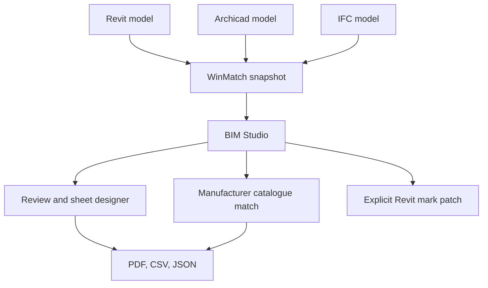

# WinMatch BIM Studio

**Beautiful window and door schedules. One open workflow from design model to supplier.**

WinMatch BIM Studio by Glazentri is an open-source, local-first fenestration coordination toolkit. It is designed for architects, BIM managers, designers, builders, estimators and window suppliers who want more usable model data without locking their workflow to a single manufacturer or software subscription.

**Early developer preview · v0.1.0 · MIT licence**

A single fenestration suite spanning BIM, take-off, specification, visual documentation, estimating, manufacturer handovers and climate-aware design.

Open [the interactive demo](dist/WinMatch-BIM-Studio.html) in a modern browser. It works offline and requires no account, server or API key. The sample project is fictional. The Revit and Archicad connectors are source previews pending verification in licensed host applications. No claim is made that the preview is ready for a production BIM or manufacturing workflow.

## What you can do

| Feature | How it works |
|---|---|
| Opening register | Scan model windows and doors, retain stable element IDs, see dimensions, level, room and family/type. |
| Visual schedules | Schematic window/door elevations, operation selectors, clear issue status and custom specifications. |
| Model review | Identify missing marks, dimensions and specifications, and flag repeated marks for review. |
| Smart marking | Suggest non-conflicting W01/D01-style marks only for blank entries. |
| Revision comparison | Compare two equivalent snapshots from the same project and source by persistent element ID. |
| Type catalogue | Group repeated sizes and specifications without losing per-opening quantities. |
| Manufacturer library | Import a generic supplier catalogue, compare exact or nearby sizes, identify specification conflicts and associate a supplier SKU without resizing geometry. |
| Manufacturer export | Map any supported source field to a supplier's documented CSV template; reorder, rename, save and reload mapping profiles, switch mm/inches. |
| Sheet designer | Create branded A4 or A3 portrait/landscape schedules with logo, revision, issue status, colour, card/table layouts, grouping, configurable column order and optional elevations. Print to PDF and reuse templates. |
| Measured quantities | Model, structural opening and actual unit size are distinct; subsill dimensions, reveal depth, opening area (m²), reveals, lintel and head flashing (lm) with configurable allowances. |
| BIM pricing | Per-opening or per-m² rates, optional installation, accessory rates, markup, tax, currency and a completeness-aware estimate export. |
| Auto-labelling | Native Revit tag placement in selected floor plans, elevations or both; skip existing tags and blank marks. Native Archicad bulk labels via documented host command. |
| Curtain wall studio | Read-only Revit grid summaries plus a separate variable-bay module designer, panel types, gross area and theoretical mullion lengths. |
| Site climate | Manual site orientation and seasonal wind inputs, hemisphere-aware approximate solar compass; Revit location read-out. |
| Databuild bridge | QGen job-variable carrier XML and training project, based on the documented XML assignment syntax. |
| Bluebeam bridge | Import Revu markup-summary CSV; 36 original selectable PDF markers and native tool-chest creation kit. |
| Revit mark write-back | Explicit review, model and current-mark validation, one undoable transaction. |
| Revit family library | Select trusted local window/door RFA definitions, load without intentionally replacing existing families, place using native Revit tools. |
| Open IFC bridge | Optional IfcOpenShell connector for models from additional BIM applications. |

## Try it in 30 seconds

1. Download or clone this repository.
2. Open `dist/WinMatch-BIM-Studio.html` locally in Edge, Chrome, Firefox or Safari.
3. Explore **Schedule**, **Model review**, **Manufacturer library**, **Sheet designer** and **Revision compare**.
4. Select **Export** to download portable JSON or CSV. Try a manufacturer mapping with the example catalogue in `docs/examples/`.

No model software is needed for the demo.

## Supported host targets

These are development targets, not verified compatibility claims.

| Connector | Platform / target | Approach | Host writes |
|---|---|---|---|
| Autodesk Revit | Windows · Revit 2025/2026 | Native C# .NET 8 ribbon add-in, launching a local Studio document | Reviewed mark update, approved local RFA family import and category tags |
| Graphisoft Archicad | Windows/macOS · Archicad 27–29 target | Official JSON API and Python Palette/terminal companion | Read-only |
| IFC | Windows/macOS/Linux · IFC2x3/IFC4 target | IfcOpenShell reader, standalone command | Read-only |
| Standalone | Modern desktop browser; responsive layout | Self-contained HTML/JS, file exchange | None |

The repository does **not** contain compiled Revit DLLs, Archicad APX binaries, a native Archicad C++ add-on, signed installers, proprietary manufacturer product libraries, or certified vendor import profiles. Revit and Archicad are licensed applications. Native Archicad tag creation and IFC export use the host's own commands rather than the Python bridge. A native Bluebeam .btx or Databuild database backup is not supplied; the authoring kit and documented carrier XML are supplied. Build and smoke-test with the installed host and SDK before distributing release binaries.

### Revit

Prerequisites: Revit 2025 or 2026, .NET 8 SDK, Windows PowerShell. Close Revit before installing. The generated Studio is already included.

From the repository root:

```powershell
.\revit\install.ps1 -Version 2026
```

For a non-default installation, pass `-RevitPath "D:\Autodesk\Revit 2026"`.

Restart Revit. The **WinMatch > BIM Studio** ribbon exposes Open Studio, Selected openings, Locate by mark, Export IFC, Auto-tag views, Load RFA library, and Apply marks. See [Revit installation and workflow](docs/revit.md).

### Archicad

Prerequisites: the matching Archicad version and a Python installation with Tk for the property-mapping wizard.

```bash
python -m venv .venv
# Activate the environment using the instructions for your OS.
python -m pip install -r archicad/requirements.txt
python archicad/winmatch_archicad.py --configure
```

Open the project in Archicad first. In the mapping wizard, select the actual window/door properties used by that project (there is no universal library property naming convention). Use the same project ID and confirmed dimension basis for subsequent revisions. Run again or configure the script in Archicad's Python Palette. See [Archicad installation and workflow](docs/archicad.md).

### IFC

```bash
python -m pip install -r ifc/requirements.txt
python ifc/import_ifc.py path/to/model.ifc
```

See [IFC workflow](docs/ifc.md) for Revit IFC4 export and Archicad IFC Translator guidance; native-host exports are kept separate from the canonical JSON.

## Workflow in practice



1. Scan the active model.
2. Review incomplete rows and draft schedule metadata.
3. Match catalogue products and build a supplier-ready schedule.
4. Save your baseline snapshot. Use the same scan scope and identity when comparing future revisions.
5. Export a customised schedule or vendor-mapped CSV. Confirm dimensions and handing with the chosen manufacturer.
6. Optionally apply only a reviewed mark patch back in Revit, then rescan.

## Manufacturer interoperability

The manufacturer handover is **an open, configurable CSV mapping layer**, not a claim of direct Logikal, Klaes, Windowmaker, or CNC compatibility. Those adapters should be implemented against vendor-supplied documentation and validated import/export fixtures. Manufacturer libraries can be imported as generic CSV/JSON product data; native model objects are separately loaded using host tools.

See [manufacturer integration guide](docs/manufacturers.md), [data contract](docs/data-contract.md), and [schedule designer guide](docs/schedules.md).

## Estimating and additional tools

- [Quantity and pricing guide](docs/quantities-pricing.md): nominal and structural opening sizes, actual sizes, subsills, reveal depth, formula assumptions and estimate rates.
- [Curtain wall and site climate](docs/design-tools.md): separate visual coordination workspaces, field provenance and limitations.
- [Databuild example project and QGen guide](integrations/databuild/README.md).
- [Bluebeam tool-chest authoring kit](integrations/bluebeam/README.md).

## Development and tests

The core is deliberately dependency-free JavaScript and HTML. Python bridge tools use standard-library components plus one optional host-specific dependency. No telemetry or external scripts.

```bash
python scripts/build_studio.py
node --test tests/*.test.cjs
python -m unittest discover -s tests -p 'test_*.py'
python -m pip install playwright
python -m playwright install chromium
python tests/browser_test.py
```

See [architecture and contribution guide](docs/architecture.md), [host verification matrix](docs/release-checklist.md), and [CONTRIBUTING.md](CONTRIBUTING.md).
The generated file in `dist/` is intentional: rebuild it after changing `studio/`.

### Repository structure

```text
studio/          HTML template and portable schedule engine
dist/            Self-contained offline Studio
revit/           Native Revit ribbon add-in source and installer scripts
archicad/        Archicad Python Palette companion and mapping wizard
ifc/             Optional IfcOpenShell bridge
integrations/    Databuild QGen example and Bluebeam markup authoring kit
scripts/         Build and safe local snapshot launcher
schema/          Versioned interchange contracts
docs/            User guides, examples, architecture and release checklist
tests/           Automated core, connector contract, and browser tests
.github/         CI, issue templates and PR template
```

## Privacy and model integrity

- Local processing: no account, email, analytics, hosted backend or automatic uploads.
- The connectors create local snapshots, including a generated Studio HTML document containing project data. Treat these files as project records. The connectors use a temporary output directory by default; delete those files when no longer required or use an explicit output path.
- Host geometry is never automatically changed. Native Revit tag placement is explicit and undoable. Revit mark updates require a separate reviewed patch and native confirmation. Revit family import loads definitions only. Archicad and IFC scans are read-only.
- Unknown dimensions and properties stay blank. Schematic diagrams are not fabrication drawings; completeness indicators are not engineering or regulatory approval.

## Direction

The goal is to make model-to-fenestration coordination genuinely open, with a common interchange contract between BIM authoring, tendering, product selection and manufacturer systems. The next release gates are host integration validation, native docked palettes, verified manufacturer import/export adapters, expanded glazing and performance properties, and accessibility testing.

Contributions from BIM practitioners, developers and manufacturers are welcome.

## Licence

[MIT](LICENSE) for the original WinMatch BIM Studio source. Autodesk and Graphisoft SDKs and applications are not bundled or sublicensed. IfcOpenShell and Graphisoft's Python package have their own licences and distribution terms; see [THIRD_PARTY.md](THIRD_PARTY.md). Third-party trademarks identify interoperability targets, not endorsement.

**WinMatch BIM Studio · by Glazentri**
